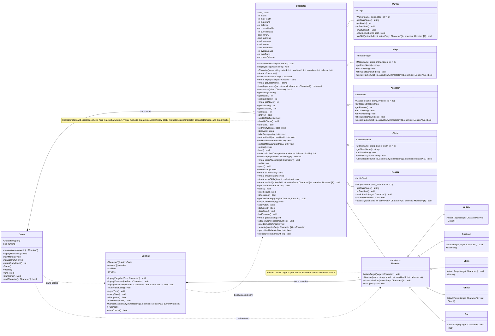

# UML class diagram

The diagram uses Mermaid class-diagram syntax and renders on GitHub. In the member lists, `+` means public, `#` protected, and `-` private. `Character*[]` and `Monster*[]` represent vectors of pointers; `&` marks a reference. C++ `const` qualifiers are omitted for readability.

